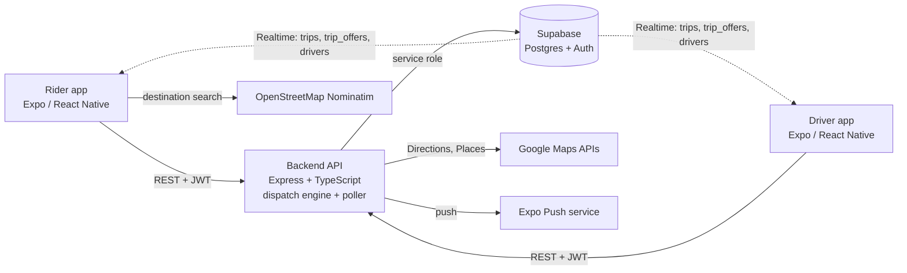

# Wasel

Wasel (واصل) is a ride-hailing MVP built for Jordan and the wider MENA region. This monorepo contains two Expo / React Native mobile apps (one for riders, one for drivers), a Node/TypeScript backend that handles authentication, fare estimates and driver dispatch, and the supporting Supabase schema, marketing sites and pitch deck. Both apps are bilingual (English and Arabic, with right-to-left layout) and use Supabase Realtime to keep trips, offers and driver locations live.

The project is an MVP in active development. A `WAITLIST_MODE` flag lets the backend and apps run in waitlist-only mode before launch.

## Features

**Rider app (`rider/`)**
- Phone-number sign-in with a one-time code (Supabase Auth, proxied through the backend)
- Map with pickup selection and destination search (OpenStreetMap Nominatim, biased to the region)
- Fare, distance and duration estimate with a route polyline before requesting
- Ride request with cash or CliQ recorded as the payment method
- Live trip tracking: status changes and driver location arrive over Supabase Realtime
- Cancel a ride before it is under way, see the driver's contact details during an active trip, and rate the driver afterwards
- Trip history and an "Explore Amman" tab (restaurants, cafes, landmarks, shopping)
- Push notifications through Expo

**Driver app (`driver/`)**
- Registration with vehicle make, model and plate; accounts wait in a pending screen until approved
- Online/offline toggle with live location updates (background location is configured in the app config)
- Incoming trip offers with accept and decline, then step-through trip status (en route, arrived, in progress, completed)
- One-tap hand-off to Google Maps or Apple Maps for navigation
- Earnings screen with trip count, total and daily earnings, and average rating

**Dispatch and matching (`backend/src/dispatch/`)**
- One offer at a time: the best-scoring available driver gets a 15-second offer; on decline or timeout the next driver is tried, up to 5 rounds, after which the trip is cancelled
- Driver score = 0.35 proximity + 0.25 subscription tier + 0.15 activity + 0.10 idle time + 0.15 rating
- Subscription tier sets the dispatch radius: 5 km (standard), 7 km (Silver), 10 km (Gold), 15 km (Platinum)
- Retries are driven by a database-backed poller (every 5 seconds) rather than in-memory timers, so a restart does not lose in-flight trips
- Trip status follows an explicit state machine; fares are calculated server-side (0.50 JD base + 0.35 JD per km, 1.50 JD minimum) and never accepted from clients
- Ratings in both directions, with aggregates recomputed from the trips table

**Cross-cutting**
- English and Arabic strings with RTL switching in both apps
- `packages/shared` provides a dark map style, an error boundary, push-token registration, and a startup-health "crash-loop breaker" that boots into a safe recovery screen after repeated failed launches

## Architecture



The apps call the backend for anything with business logic (auth, trip creation, accepting offers, status changes, ratings) and subscribe directly to Supabase Realtime for live updates, protected by row-level security policies. The backend uses a Supabase service-role client, validates input with Zod, and resolves the caller's role (rider or driver) from the JWT's `app_metadata`.

## Tech stack

| Area | Technology |
| --- | --- |
| Mobile apps | Expo SDK 54, React Native 0.81, React 19, Expo Router, react-native-maps |
| Shared code | npm workspace `@wasel/shared` (TypeScript) |
| Backend | Node 20, Express 4, TypeScript, Zod, Helmet, express-rate-limit |
| Data and auth | Supabase (Postgres, phone OTP auth, Realtime, RLS) |
| External APIs | Google Directions, Google Places, Expo Push, OpenStreetMap Nominatim |
| Builds and deploy | EAS Build, local TestFlight script, Docker, Railway |
| Websites | Static landing page (`website/`), Vite + React + Tailwind + GSAP + Framer Motion (`website-v2/`) |

## Repository layout

| Path | Contents |
| --- | --- |
| `rider/` | Rider Expo app (`app/`, `contexts/`, `lib/`, `eas.json`, `app.config.js`) |
| `driver/` | Driver Expo app (same structure as `rider/`) |
| `backend/` | Express API: `src/routes`, `src/dispatch`, `src/middleware`, `src/lib` |
| `backend/supabase/` | SQL migrations `001` to `015`, plus seed and reset scripts |
| `packages/shared/` | Code shared by both apps |
| `website/`, `website-v2/` | Marketing sites |
| `pitchdeck/` | Static pitch deck, published to GitHub Pages by `.github/workflows/pages.yml` |
| `docs/plans/` | Implementation plans for the scaffold and MVP launch |
| `Dockerfile`, `railway.toml` | Backend container and Railway deploy settings |
| `ship.sh` | Local build-and-upload script for TestFlight |

## Local development

Requirements: Node 20.x exactly (see `.nvmrc`; the root `preinstall` script enforces it), npm, and a Supabase project. Native map features generally need a development build rather than Expo Go.

```bash
nvm use
npm install                          # installs the root workspaces: rider, driver, packages/*
npm --prefix backend install         # the backend is not part of the root workspaces
```

1. Create a Supabase project and apply `backend/supabase/migrations/001` to `015` in order (Supabase SQL editor or CLI).
2. Copy each `.env.example` to `.env` and fill in your own values (see below).
3. Run the pieces:

```bash
npm run backend:dev    # API on PORT (default 3001), health check at /health
npm run rider          # Expo dev server for the rider app
npm run driver         # Expo dev server for the driver app
npm run backend:build  # compile the backend to backend/dist
```

For a native build, run `npm run ios` or `npm run android` from inside `rider/` or `driver/`.

### Configuration

All secrets stay in untracked `.env` files; only variable names are listed here.

| File | Variables |
| --- | --- |
| `backend/.env.example` | `SUPABASE_URL`, `SUPABASE_SERVICE_ROLE_KEY`, `PORT`, `NODE_ENV`, `ALLOWED_ORIGINS`, `WAITLIST_MODE`, `TEST_BYPASS_ENABLED`, `DEV_TEST_PASSWORD`, `GOOGLE_PLACES_API_KEY`, `GOOGLE_DIRECTIONS_API_KEY`, `EXPO_ACCESS_TOKEN` |
| `rider/.env.example`, `driver/.env.example` | `EXPO_PUBLIC_SUPABASE_URL`, `EXPO_PUBLIC_SUPABASE_ANON_KEY`, `EXPO_PUBLIC_API_URL`, `GOOGLE_MAPS_API_KEY`, `EXPO_PUBLIC_WAITLIST_MODE` |

The Google Directions and Places keys are optional. Without them, `/api/trips/estimate` falls back to straight-line distance and `/api/explore` serves a curated list of Amman places.

## API overview

| Route group | Purpose |
| --- | --- |
| `/health` | Liveness check and waitlist-mode flag |
| `/api/waitlist` | Waitlist sign-up and count (the only data routes open in waitlist mode) |
| `/api/auth` | Send and verify OTP, role assignment |
| `/api/trips` | Estimate, create, accept, decline, status transitions, active/pending lookup, contact, rating |
| `/api/drivers` | Registration, location, online status, profile, push token, trip history |
| `/api/riders` | Profile, push token, trip history |
| `/api/explore` | Places to visit, optionally filtered by category |

## Deployment

- **Backend:** the root `Dockerfile` builds only `backend/` on `node:20-alpine` and runs `node dist/index.js`. `railway.toml` points Railway at that Dockerfile with a `/health` check and restart-on-failure; `backend/railway.toml` is a Nixpacks alternative for a service rooted in `backend/`. Set the backend variables above in the Railway dashboard.
- **Mobile builds:** each app has an `eas.json` with `development`, `preview`, `testflight` and `production` profiles. `app.config.js` reads `GOOGLE_MAPS_API_KEY` at build time; supply it as an EAS secret.
- **TestFlight without EAS credits:** `./ship.sh rider` or `./ship.sh driver` builds on a Mac and uploads to TestFlight. Copy `.ship-secrets.example` to `.ship-secrets` (gitignored); it needs `APPLE_TEAM_ID`, `ASC_KEY_ID`, `ASC_ISSUER_ID` and `API_URL`.
- **Pitch deck:** pushes to `main` publish `pitchdeck/` to GitHub Pages.

## Security notes

- The backend refuses to start if `NODE_ENV=production` and `TEST_BYPASS_ENABLED=true`. That flag enables test logins, auto-approval of drivers and an unlimited dispatch radius, so it is for local development only.
- Global and per-route rate limits, per-phone OTP throttling, Helmet, request-size limits, and Zod validation on request bodies and queries.
- Row-level security on Supabase tables; waitlist-membership columns are not writable by clients.
- See `backend/SECURITY_AUDIT.md` for the findings and fixes from the April 2026 audit.
